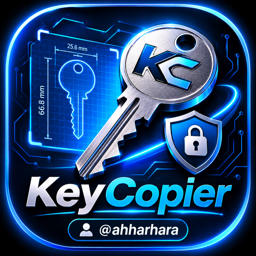

<div align="center">



# KeyCopier Pro — محاكاة وتوسيع أداة KeyCopier للأندرويد

**100% Offline-First • Zero-Network • Open Source Optical & CAD Key Decoder**

[](LICENSE)
[](https://developer.android.com)
[](https://kotlinlang.org)
[](SECURITY.md)

</div>

---

## نظرة عامة | Overview

**KeyCopier Pro** هو تطبيق أندرويد هندسي مفتوح المصدر يعمل **محلياً بالكامل (100% Offline / Zero-Network)**، مستوحى من أداة KeyCopier في جهاز Flipper Zero ومطوّر بقدرات CAD و3D متقدمة على الهاتف. يتيح التطبيق فك تشفير أسنان المفاتيح، معايرة القياس بالمليمتر، وتوليد قوالب جاهزة للقص بالليزر/CNC أو الطباعة ثلاثية الأبعاد، مع حفظ البيانات في خزنة محلية مشفرة بالكامل.

**KeyCopier Pro** is an open-source, 100% offline-first Android engineering utility inspired by Flipper Zero's KeyCopier. It extracts physical key bitting codes via ISO ID-1 optical calibration or direct 1:1 on-screen placement, and exports fabrication-ready 2D CAD and 3D printable STL models—while keeping all user data encrypted locally with zero network permissions.

---

## المميزات الأساسية | Key Features

- **معايرة بصرية عبر بطاقة ISO ID-1 (`85.60 × 53.98 mm`):**
  التقاط صورة بالـ CameraX أو اختيار صورة عبر Android Photo Picker، وتصحيح المنظور (8-DOF Projective Homography) للحصول على مقياس عمودي دقيق بالمليمتر.
- **صفحة القياس الطولية بملء الشاشة (1:1 Longitudinal Pad) + مسطرة الشاشة:**
  وضع المفتاح طولياً على زجاج الشاشة المعاير (DPI Calibration) والتحكم بالأسنان بثلاث طرق مرنة:
  1. **اللمس المباشر (Touch Drag)** مع خيار قفل/فتح المسافات.
  2. **أزرار الأسهم (Directional Arrows)** لرفع/خفض عمق السن والتنقل بين الأسنان.
  3. **أزرار الأرقام السريعة (`0 مستوي` إلى `9`)**.
- **دعم المفاتيح أحادية وثنائية الجهة (Single-Sided & Double-Sided Blades):**
  توليد وعرض وتصدير المفاتيح ذات الجهة الواحدة أو «أبو جهتين» بتناظر هندسي دقيق.
- **معايير الأقفال القياسية + الوضع الحر:**
  `Schlage SC1 / SC4`, `Kwikset KW1 / KW10`, `Yale Y1`, `Weiser WR5`, `Arrow AR1`, `Master Lock M1`, بالإضافة إلى `CUSTOM` الحر.
- **مركز القوالب والتصنيع (Fabrication & 3D Export):**
  - مجسم ثلاثي الأبعاد **`.STL`** (Binary & ASCII) مع عارض تفاعلي 360°.
  - مخططات متجهة ثنائية الأبعاد بمقياس حقيقي 1:1 بصيغة **`.SVG`** و **`.DXF` (AutoCAD CNC)**.
  - مخطط طباعة ورقي بمقياس حقيقي **`.PDF (1:1 Scale)`** مع مربع معايرة `50 × 50 mm`، وصورة **`.PNG`** عالية الدقة.
  - نسخ احتياطي مشفر **`.KCB` (AES-256-GCM)** أو **`.JSON`**.
- **أمان وعزل كامل عن الشبكة (Zero-Cloud Security):**
  - إزالة صلاحيتي `INTERNET` و `ACCESS_NETWORK_STATE` من الـ Manifest نهائياً.
  - قفل برمز PIN مخصص (PBKDF2-HMAC-SHA256) + دعم البصمة `BiometricPrompt`.
  - قاعدة بيانات Room مشفرة بـ **SQLCipher**، وتشفير المرفقات والصور بـ **Android Keystore (AES-256-GCM)**.
- **دعم ثنائي اللغة (العربية RTL والإنجليزية LTR).**

---

## التقنيات المستخدمة | Tech Stack

- **Language & UI:** Kotlin, Jetpack Compose, Material Design 3
- **Architecture:** MVVM, StateFlow, Navigation Compose (Type-safe routes)
- **Database & Security:** Room + SQLCipher, Android Keystore AES-256-GCM, EncryptedSharedPreferences, BiometricPrompt
- **Camera & Media:** CameraX, Android Photo Picker (Zero storage permission), Storage Access Framework (SAF), FileProvider
- **Geometry & CAD:** Pure Kotlin Homography Rectifier, Parametric Key Polygon Builder, Ear-Clipping 3D STL Mesh Extruder, Vector SVG/DXF/PDF/PNG Generators
- **Testing:** JUnit4 + Robolectric + Compose UI Tests

---

## البناء والتحميل والتثبيت على الأجهزة | Build & Install APK on GitHub

### الطريقة السريعة عبر GitHub Releases / Actions (تلقائياً فور الرفع):
1. ادفع المشروع إلى مستودعك على GitHub (عبر **Push to GitHub** في AI Studio أو عبر Git).
2. فور وصول الكود، يبدأ GitHub تلقائياً بتشغيل الاختبارات وبناء ملف **`KeyCopier-Pro-v1.0-release.apk`** (وملف `debug.apk` + `SHA256SUMS.txt`).
3. انتقل إلى قسم **Releases** في يمين صفحة المستودع (إصدار **`v1.0.0`**) أو من تبويب **Actions -> Artifacts** لتحميل `KeyCopier-Pro-v1.0-release.apk` وتثبيته مباشرة على أجهزة أندرويد.
4. *(اختياري لتوقيع مستمر بمفتاحك الدائم)*: يمكنك إضافة الأسرار `KEYSTORE_BASE64` و `STORE_PASSWORD` و `KEY_PASSWORD` في **GitHub Repository Secrets**، وفي حال عدم إضافتها سيُنشئ سير العمل مفتاح توقيع Release جاهزاً تلقائياً عند البناء.

### البناء محلياً | Local CLI Build

```bash
# Build Installable Debug APK
gradle :app:assembleDebug

# Run Unit & Robolectric UI Tests
gradle :app:testDebugUnitTest
```

> **Note:** This project intentionally blocks `INTERNET` permissions at the manifest level (`tools:node="remove"`). See [SECURITY.md](SECURITY.md) for details.

---

## المطور وحقوق الملكية | Developer & Ownership

هذا المشروع **مفتوح المصدر (Open Source)** بموجب رخصة [MIT License](LICENSE).

- **برمجة وتطوير:** أحمد أمين بن هرهرة
- **Programmed & Developed by:** **AHMED AMEEN BAN HARHARA**
- **GitHub:** [@ahharhara](https://github.com/ahharhara)
